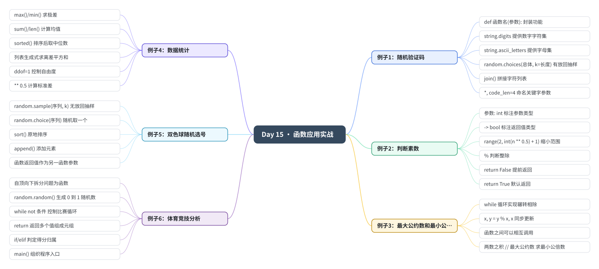

## 函数应用实战



### 例子1：随机验证码

设计一个生成随机验证码的函数，验证码由数字和英文大小写字母构成，长度可以通过参数设置。

```python
import random
import string

ALL_CHARS = string.digits + string.ascii_letters


def generate_code(*, code_len=4):
    """
    生成指定长度的验证码
    :param code_len: 验证码的长度(默认4个字符)
    :return: 由大小写英文字母和数字构成的随机验证码字符串
    """
    return ''.join(random.choices(ALL_CHARS, k=code_len))
```

> **说明1**：`string`模块的`digits`代表0到9的数字构成的字符串`'0123456789'`，`string`模块的`ascii_letters`代表大小写英文字母构成的字符串`'abcdefghijklmnopqrstuvwxyzABCDEFGHIJKLMNOPQRSTUVWXYZ'`。
>
> **说明2**：`random`模块的`sample`和`choices`函数都可以实现随机抽样，`sample`实现无放回抽样，这意味着抽样取出的元素是不重复的；`choices`实现有放回抽样，这意味着可能会重复选中某些元素。这两个函数的第一个参数代表抽样的总体，而参数`k`代表样本容量，需要说明的是`choices`函数的参数`k`是一个命名关键字参数，在传参时必须指定参数名。

可以用下面的代码生成5组随机验证码来测试上面的函数。

```python
for _ in range(5):
    print(generate_code()) 
```

输出：

```
59tZ
QKU5
izq8
IBBb
jIfX
```

或者

```python
for _ in range(5):
    print(generate_code(code_len=6))
```

输出：

```
FxJucw
HS4H9G
0yyXfz
x7fohf
ReO22w
```

> **说明**：我们设计的`generate_code`函数的参数是命名关键字参数，由于它有默认值，可以不给它传值，使用默认值4。如果需要给函数传入参数，必须指定参数名`code_len`。

### 例子2：判断素数

设计一个判断给定的大于1的正整数是不是质数的函数。质数是只能被1和自身整除的正整数（大于1），如果一个大于 1 的正整数 $\small{N}$ 是质数，那就意味着在 2 到 $\small{N-1}$ 之间都没有它的因子。

```python
def is_prime(num: int) -> bool:
    """
    判断一个正整数是不是质数
    :param num: 大于1的正整数
    :return: 如果num是质数返回True，否则返回False
    """
    for i in range(2, int(num ** 0.5) + 1):
        if num % i == 0:
            return False
    return True
```

> **说明1**：上面`is_prime`函数的参数`num`后面的`: int`用来标注参数的类型，虽然它对代码的执行结果不产生任何影响，但是很好的增强了代码的可读性。同理，参数列表后面的`-> bool`用来标注函数返回值的类型，它也不会对代码的执行结果产生影响，但是却让我们清楚的知道，调用函数会得到一个布尔值，要么是`True`，要么是`False`。
>
> **说明2**：上面的循环并不需要从 2 循环到 $\small{N-1}$ ，因为如果循环进行到 $\small{\sqrt{N}}$ 时，还没有找到$\small{N}$的因子，那么 $\small{\sqrt{N}}$ 之后也不会出现 $\small{N}$ 的因子，大家可以自己想一想这是为什么。

### 例子3：最大公约数和最小公倍数

设计计算两个正整数最大公约数和最小公倍数的函数。 $\small{x}$ 和 $\small{y}$ 的最大公约数是能够同时整除 $\small{x}$ 和 $\small{y}$ 的最大整数，如果 $\small{x}$ 和 $\small{y}$ 互质，那么它们的最大公约数为 1； $\small{x}$ 和 $\small{y}$ 的最小公倍数是能够同时被 $\small{x}$ 和 $\small{y}$ 整除的最小正整数，如果 $\small{x}$ 和 $\small{y}$ 互质，那么它们的最小公倍数为 $\small{x \times y}$ 。需要提醒大家注意的是，计算最大公约数和最小公倍数是两个不同的功能，应该设计成两个函数，而不是把两个功能放到同一个函数中。

```python
def lcm(x: int, y: int) -> int:
    """求最小公倍数"""
    return x * y // gcd(x, y)


def gcd(x: int, y: int) -> int:
    """求最大公约数"""
    while y % x != 0:
        x, y = y % x, x
    return x
```

> **说明**：函数之间可以相互调用，上面求最小公倍数的`lcm`函数调用了求最大公约数的`gcd`函数，通过 $\frac{x \times y}{ gcd(x, y)}$ 来计算最小公倍数。

### 例子4：数据统计

假设样本数据保存一个列表中，设计计算样本数据描述性统计信息的函数。描述性统计信息通常包括：算术平均值、中位数、极差（最大值和最小值的差）、方差、标准差、变异系数等，计算公式如下所示。

样本均值（sample mean）：

$$
\bar{x} = \frac{\sum_{i=1}^{n}x_{i}}{n} = \frac{x_{1}+x_{2}+\cdots +x_{n}}{n}
$$

样本方差（sample variance）：

$$
s^2 = \frac {\sum_{i=1}^{n}(x_i - \bar{x})^2} {n-1}
$$

样本标准差（sample standard deviation）：

$$
s = \sqrt{\frac{\sum_{i=1}^{n}(x_i - \bar{x})^2}{n-1}}
$$

变异系数（coefficient of sample variation）：

$$
CV = \frac{s}{\bar{x}}
$$

```python
def ptp(data):
    """极差（全距）"""
    return max(data) - min(data)


def mean(data):
    """算术平均"""
    return sum(data) / len(data)


def median(data):
    """中位数"""
    temp, size = sorted(data), len(data)
    if size % 2 != 0:
        return temp[size // 2]
    else:
        return mean(temp[size // 2 - 1:size // 2 + 1])


def var(data, ddof=1):
    """方差"""
    x_bar = mean(data)
    temp = [(num - x_bar) ** 2 for num in data]
    return sum(temp) / (len(temp) - ddof)


def std(data, ddof=1):
    """标准差"""
    return var(data, ddof) ** 0.5


def cv(data, ddof=1):
    """变异系数"""
    return std(data, ddof) / mean(data)


def describe(data):
    """输出描述性统计信息"""
    print(f'均值: {mean(data)}')
    print(f'中位数: {median(data)}')
    print(f'极差: {ptp(data)}')
    print(f'方差: {var(data)}')
    print(f'标准差: {std(data)}')
    print(f'变异系数: {cv(data)}')
```

> **说明1**：中位数是将数据按照升序或降序排列后位于中间的数，它描述了数据的中等水平。中位数的计算分两种情况：当数据体量$n$为奇数时，中位数是位于 $\frac{n + 1}{2}$ 位置的元素；当数据体量 $\small{n}$ 为偶数时，中位数是位于 $\frac{n}{2}$ 和 $\frac{n}{2} + 1$ 两个位置元素的均值。
>
> **说明2**：计算方差和标准差的函数中有一个名为`ddof`的参数，它代表了可以调整的自由度，默认值为 1。在计算样本方差和样本标准差时，需要进行自由度校正；如果要计算总体方差和总体标准差，可以将`ddof`参数赋值为 0，即不需要进行自由度校正。
>
> **说明3**：`describe`函数将上面封装好的统计函数组装到一起，用于输出数据的描述性统计信息。事实上，Python 标准库中有一个名为`statistics`的模块，它已经把获取描述性统计信息的函数封装好了，有兴趣的读者可以自行了解。

### 例子5：双色球随机选号

我们用函数重构之前讲过的双色球随机选号的例子（《第09课：常用数据结构之列表-2》），将生成随机号码和输出一组号码的功能分别封装到两个函数中，然后通过调用函数实现机选`N`注号码的功能。

```python
"""
双色球随机选号程序

Author: 骆昊
Version: 1.3
"""
import random

RED_BALLS = [i for i in range(1, 34)]
BLUE_BALLS = [i for i in range(1, 17)]


def choose():
    """
    生成一组随机号码
    :return: 保存随机号码的列表
    """
    selected_balls = random.sample(RED_BALLS, 6)
    selected_balls.sort()
    selected_balls.append(random.choice(BLUE_BALLS))
    return selected_balls


def display(balls):
    """
    格式输出一组号码
    :param balls: 保存随机号码的列表
    """
    for ball in balls[:-1]:
        print(f'\033[031m{ball:0>2d}\033[0m', end=' ')
    print(f'\033[034m{balls[-1]:0>2d}\033[0m')


n = int(input('生成几注号码: '))
for _ in range(n):
    display(choose())
```

> **说明**：大家看看`display(choose())`这行代码，这里我们先通过`choose`函数获得一组随机号码，然后把`choose`函数的返回值作为`display`函数的参数，通过`display`函数将选中的随机号码显示出来。重构之后的代码逻辑非常清晰，代码的可读性更强了。如果有人为你封装了这两个函数，你仅仅是函数的调用者，其实你根本不用关心`choose`函数和`display`函数的内部实现，你只需要知道调用`choose`函数可以生成一组随机号码，而调用`display`函数传入一个列表，就可以输出这组号码。将来我们使用各种各样的 Python 三方库时，我们也根本不关注它们的底层实现，我们需要知道的仅仅是调用哪个函数可以解决问题。

### 例子6：体育竞技分析

之前的例子都是用函数封装一个功能，接下来我们通过一个综合性的例子，为大家展示**自顶向下（top-down）的程序设计方法**。所谓自顶向下，就是**先把一个复杂的问题拆分成若干个容易解决的小问题，再把每个小问题继续拆分，直到每个小问题都可以用一个函数轻松实现为止**，然后再自底向上地逐个实现这些函数。

**问题**：模拟两名羽毛球运动员的比赛，当一名球员的得分概率较高时，赢下比赛的概率到底有多大？我们做如下假设：输入两个球员各自的得分概率（每个回合该球员得分的可能性）和模拟比赛的场次，比赛采用 21 分制，先得 21 分且比对方多 2 分的一方获胜。

按照自顶向下的思路，我们可以把整个程序拆分成四个函数：

1. `get_inputs`：获取球员的得分概率和模拟场次，负责程序的输入；
2. `sim_n_games`：模拟 n 场比赛，分别调用`sim_one_game`函数模拟每一场比赛；
3. `sim_one_game`：模拟一场比赛，交替调用`sim_a_point`函数模拟每个回合；
4. `sim_a_point`：模拟一个回合，根据球员的得分概率随机产生这一分归属于谁。

四个函数中，`sim_a_point`是最底层的、最简单的，往上每一层只需要关心调用下一层的函数能得到什么结果，而不需要关心它是怎么实现的，这也正是前面讲过的函数封装的意义所在。程序的完整代码如下所示。

```python
"""
体育竞技分析程序：根据球员的得分概率，模拟比赛估算获胜的几率

Author: 骆昊
Version: 1.0
"""
import random


def get_inputs():
    """
    获取用户输入的球员得分概率和模拟比赛的场次
    :return: 球员A的得分概率、球员B的得分概率、模拟比赛的场次
    """
    prob_a = float(input('球员A每回合的得分概率(0~1): '))
    prob_b = float(input('球员B每回合的得分概率(0~1): '))
    n = int(input('模拟比赛的场次: '))
    return prob_a, prob_b, n


def sim_a_point(prob_a, prob_b):
    """
    模拟一个回合，根据两名球员的得分概率判定这一分归属于谁
    :param prob_a: 球员A的得分概率
    :param prob_b: 球员B的得分概率
    :return: 'A'或'B'，表示这一分归属于哪个球员
    """
    return 'A' if random.random() < prob_a else 'B'


def sim_one_game(prob_a, prob_b):
    """
    模拟一场21分制的比赛（先得21分且比对方多2分的一方获胜）
    :param prob_a: 球员A的得分概率
    :param prob_b: 球员B的得分概率
    :return: 球员A和球员B各自的总得分
    """
    score_a, score_b = 0, 0
    while not game_over(score_a, score_b):
        if sim_a_point(prob_a, prob_b) == 'A':
            score_a += 1
        else:
            score_b += 1
    return score_a, score_b


def game_over(score_a, score_b):
    """
    判断一场比赛是否已经结束
    :param score_a: 球员A的得分
    :param score_b: 球员B的得分
    :return: 比赛结束返回True，否则返回False
    """
    # 得分达到21分且领先对手2分（或以上）的比赛才结束，
    # 这里的>=不能写成==，因为出现21平之后比分还会继续增长
    return max(score_a, score_b) >= 21 and abs(score_a - score_b) >= 2


def sim_n_games(prob_a, prob_b, n):
    """
    模拟n场比赛，统计两名球员获胜的场次
    :param prob_a: 球员A的得分概率
    :param prob_b: 球员B的得分概率
    :param n: 模拟比赛的场次
    :return: 球员A和球员B各自获胜的场次
    """
    wins_a, wins_b = 0, 0
    for _ in range(n):
        score_a, score_b = sim_one_game(prob_a, prob_b)
        if score_a > score_b:
            wins_a += 1
        else:
            wins_b += 1
    return wins_a, wins_b


def print_summary(wins_a, wins_b):
    """
    打印比赛模拟的结果汇总
    :param wins_a: 球员A获胜的场次
    :param wins_b: 球员B获胜的场次
    """
    n = wins_a + wins_b
    print(f'共模拟{n}场比赛：')
    print(f'球员A获胜{wins_a}场，占比{wins_a / n:.1%}')
    print(f'球员B获胜{wins_b}场，占比{wins_b / n:.1%}')


def main():
    """程序的入口函数，把整个程序按流程串起来"""
    prob_a, prob_b, n = get_inputs()
    wins_a, wins_b = sim_n_games(prob_a, prob_b, n)
    print_summary(wins_a, wins_b)


if __name__ == '__main__':
    main()
```

输入：

```
球员A每回合的得分概率(0~1): 0.55
球员B每回合的得分概率(0~1): 0.45
模拟比赛的场次: 500
```

输出：

```
共模拟500场比赛：
球员A获胜369场，占比73.8%
球员B获胜131场，占比26.2%
```

> **说明**：模拟结果显示，每回合只多出`10%`的得分概率优势，最终赢下比赛的概率却超过了`70%`，这说明回合制比赛的胜负会被不断放大，这也是大家平常感觉"强者恒强"的原因。此外，程序中用`if __name__ == '__main__':`来保证这个模块被其他模块导入时不会自动执行模拟，`main`函数也不是 Python 程序必需的，但它可以让程序的流程一目了然，这是一种值得推荐的编程习惯。

### 总结

本节核心语法与用法：

- **例子1：随机验证码**：用 `def 函数名(参数):` 封装生成逻辑，`string.digits` 与 `string.ascii_letters` 提供字符集，`random.choices(总体, k=长度)` 有放回抽样，`''.join()` 拼接字符；`*, code_len=4` 声明带默认值的命名关键字参数。
- **例子2：判断素数**：用 `参数: int` 和 `-> bool` 添加类型标注（不影响执行），`range(2, int(n ** 0.5) + 1)` 缩小枚举范围，`%` 判断整除，找到因子 `return False` 提前返回，循环结束 `return True`。
- **例子3：最大公约数和最小公倍数**：用 `while y % x != 0` 配合 `x, y = y % x, x` 实现辗转相除；函数间可互相调用，最小公倍数用两数之积整除最大公约数计算。
- **例子4：数据统计**：用 `max()`/`min()` 求极差，`sum()/len()` 求均值，`sorted()` 后取中位数，列表生成式求离差平方和；`ddof=1` 控制自由度，`** 0.5` 计算标准差。
- **例子5：双色球随机选号**：`random.sample(序列, k)` 无放回抽取，`random.choice(序列)` 随机取一个，`sort()` 原地排序，`append()` 添加元素；函数的返回值可直接作为另一函数的参数。
- **例子6：体育竞技分析**：按自顶向下把问题拆成多个函数；`random.random()` 生成 0 到 1 的随机数，`while not 条件:` 控制比赛循环，`return` 用逗号返回多个值组成元组。

### 每日任务

1. **验证码生成**：用 `string.digits`、`string.ascii_letters` 和 `random.choices` 生成 4 位验证码，连续生成 5 个并输出，要求每次结果随机。
2. **数据统计**：对列表 `[12, 7, 3, 9, 15, 21]` 实现 `ptp`、`mean`、`median`、`var`、`std` 五个函数并调用输出，要求不导入 `statistics`。
3. **思考题**：双色球从 1 到 33 中选 6 个红球时，为什么应当用 `random.sample` 而不是 `random.choices(k=6)`？再说明 `sim_a_point` 中 `random.random() < prob_a` 的含义，以及把 `<` 改成 `<=` 对模拟结果的影响。
