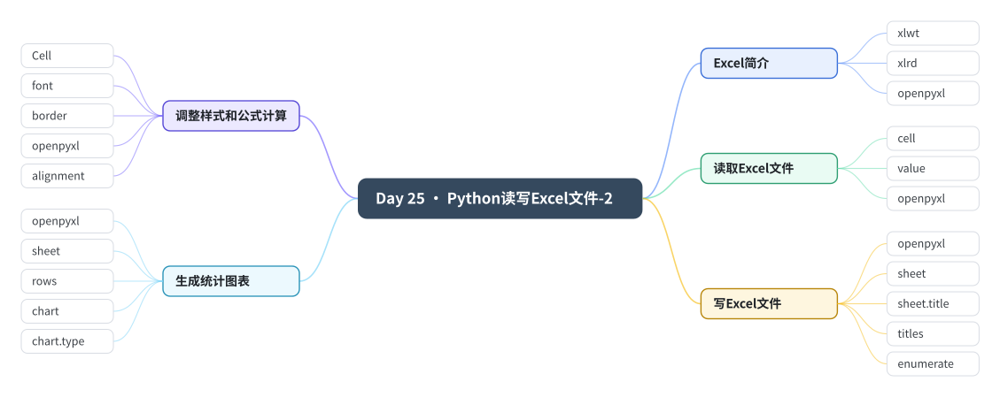

## Python读写Excel文件-2



### Excel简介

Excel 是 Microsoft（微软）为使用 Windows 和 macOS 操作系统开发的一款电子表格软件。Excel 凭借其直观的界面、出色的计算功能和图表工具，再加上成功的市场营销，一直以来都是最为流行的个人计算机数据处理软件。当然，Excel 也有很多竞品，例如 Google Sheets、LibreOffice Calc、Numbers 等，这些竞品基本上也能够兼容 Excel，至少能够读写较新版本的 Excel 文件，当然这些不是我们讨论的重点。掌握用 Python 程序操作 Excel 文件，可以让日常办公自动化的工作更加轻松愉快，而且在很多商业项目中，导入导出 Excel 文件都是特别常见的功能。

本章我们继续讲解基于另一个三方库`openpyxl`如何进行 Excel 文件操作，首先需要先安装它。

```Bash
pip install openpyxl
```

`openpyxl`的优点在于，当我们打开一个 Excel 文件后，既可以对它进行读操作，又可以对它进行写操作，而且在操作的便捷性上是优于`xlwt`和`xlrd`的。此外，如果要进行样式编辑和公式计算，使用`openpyxl`也远比上一个章节我们讲解的方式更为简单，而且`openpyxl`还支持数据透视和插入图表等操作，功能非常强大。有一点需要再次强调，`openpyxl`并不支持操作 Office 2007 以前版本的 Excel 文件。

### 读取Excel文件

例如在当前文件夹下有一个名为“阿里巴巴2020年股票数据.xlsx”的 Excel 文件，如果想读取并显示该文件的内容，可以通过如下所示的代码来完成。

```python
import datetime

import openpyxl

# 加载一个工作簿 ---> Workbook
wb = openpyxl.load_workbook('阿里巴巴2020年股票数据.xlsx')
# 获取工作表的名字
print(wb.sheetnames)
# 获取工作表 ---> Worksheet
sheet = wb.worksheets[0]
# 获得单元格的范围
print(sheet.dimensions)
# 获得行数和列数
print(sheet.max_row, sheet.max_column)

# 获取指定单元格的值
print(sheet.cell(3, 3).value)
print(sheet['C3'].value)
print(sheet['G255'].value)

# 获取多个单元格（嵌套元组）
print(sheet['A2:C5'])

# 读取所有单元格的数据
for row_ch in range(2, sheet.max_row + 1):
    for col_ch in 'ABCDEFG':
        value = sheet[f'{col_ch}{row_ch}'].value
        if type(value) == datetime.datetime:
            print(value.strftime('%Y年%m月%d日'), end='\t')
        elif type(value) == int:
            print(f'{value:<10d}', end='\t')
        elif type(value) == float:
            print(f'{value:.4f}', end='\t')
        else:
            print(value, end='\t')
    print()
```

> **提示**：上面代码中使用的Excel文件“阿里巴巴2020年股票数据.xlsx”可以通过后面的百度云盘地址进行获取。链接:https://pan.baidu.com/s/1rQujl5RQn9R7PadB2Z5g_g 提取码:e7b4。

需要提醒大家一点，`openpyxl`获取指定的单元格有两种方式，一种是通过`cell`方法，需要注意，该方法的行索引和列索引都是从`1`开始的，这是为了照顾用惯了 Excel 的人的习惯；另一种是通过索引运算，通过指定单元格的坐标，例如`C3`、`G255`，也可以取得对应的单元格，再通过单元格对象的`value`属性，就可以获取到单元格的值。通过上面的代码，相信大家还注意到了，可以通过类似`sheet['A2:C5']`或`sheet['A2':'C5']`这样的切片操作获取多个单元格，该操作将返回嵌套的元组，相当于获取到了多行多列。

### 写Excel文件

下面我们使用`openpyxl`来进行写 Excel 操作。

```python
import random

import openpyxl

# 第一步：创建工作簿（Workbook）
wb = openpyxl.Workbook()

# 第二步：添加工作表（Worksheet）
sheet = wb.active
sheet.title = '期末成绩'

titles = ('姓名', '语文', '数学', '英语')
for col_index, title in enumerate(titles):
    sheet.cell(1, col_index + 1, title)

names = ('关羽', '张飞', '赵云', '马超', '黄忠')
for row_index, name in enumerate(names):
    sheet.cell(row_index + 2, 1, name)
    for col_index in range(2, 5):
        sheet.cell(row_index + 2, col_index, random.randrange(50, 101))

# 第四步：保存工作簿
wb.save('考试成绩表.xlsx')
```

### 调整样式和公式计算

在使用`openpyxl`操作 Excel 时，如果要调整单元格的样式，可以直接通过单元格对象（`Cell`对象）的属性进行操作。单元格对象的属性包括字体（`font`）、对齐（`alignment`）、边框（`border`）等，具体的可以参考`openpyxl`的[官方文档](https://openpyxl.readthedocs.io/en/stable/index.html)。在使用`openpyxl`时，如果需要做公式计算，可以完全按照 Excel 中的操作方式来进行，具体的代码如下所示。

```python
import openpyxl
from openpyxl.styles import Font, Alignment, Border, Side

# 对齐方式
alignment = Alignment(horizontal='center', vertical='center')
# 边框线条
side = Side(color='ff7f50', style='mediumDashed')

wb = openpyxl.load_workbook('考试成绩表.xlsx')
sheet = wb.worksheets[0]

# 调整行高和列宽
sheet.row_dimensions[1].height = 30
sheet.column_dimensions['E'].width = 120

sheet['E1'] = '平均分'
# 设置字体
sheet.cell(1, 5).font = Font(size=18, bold=True, color='ff1493', name='华文楷体')
# 设置对齐方式
sheet.cell(1, 5).alignment = alignment
# 设置单元格边框
sheet.cell(1, 5).border = Border(left=side, top=side, right=side, bottom=side)
for i in range(2, 7):
    # 公式计算每个学生的平均分
    sheet[f'E{i}'] = f'=average(B{i}:D{i})'
    sheet.cell(i, 5).font = Font(size=12, color='4169e1', italic=True)
    sheet.cell(i, 5).alignment = alignment

wb.save('考试成绩表.xlsx')
```

### 生成统计图表

通过`openpyxl`库，可以直接向 Excel 中插入统计图表，具体的做法跟在 Excel 中插入图表大体一致。我们可以创建指定类型的图表对象，然后通过该对象的属性对图表进行设置。当然，最为重要的是为图表绑定数据，即横轴代表什么，纵轴代表什么，具体的数值是多少。最后，可以将图表对象添加到表单中，具体的代码如下所示。

```python
from openpyxl import Workbook
from openpyxl.chart import BarChart, Reference

wb = Workbook(write_only=True)
sheet = wb.create_sheet()

rows = [
    ('类别', '销售A组', '销售B组'),
    ('手机', 40, 30),
    ('平板', 50, 60),
    ('笔记本', 80, 70),
    ('外围设备', 20, 10),
]

# 向表单中添加行
for row in rows:
    sheet.append(row)

# 创建图表对象
chart = BarChart()
chart.type = 'col'
chart.style = 10
# 设置图表的标题
chart.title = '销售统计图'
# 设置图表纵轴的标题
chart.y_axis.title = '销量'
# 设置图表横轴的标题
chart.x_axis.title = '商品类别'
# 设置数据的范围
data = Reference(sheet, min_col=2, min_row=1, max_row=5, max_col=3)
# 设置分类的范围
cats = Reference(sheet, min_col=1, min_row=2, max_row=5)
# 给图表添加数据
chart.add_data(data, titles_from_data=True)
# 给图表设置分类
chart.set_categories(cats)
chart.shape = 4
# 将图表添加到表单指定的单元格中
sheet.add_chart(chart, 'A10')

wb.save('demo.xlsx')
```

运行上面的代码，打开生成的 Excel 文件，效果如下图所示。


###  总结

本节核心语法与用法：

- **Excel简介**：`openpyxl` 可同时读写 `xlsx`，安装用 `pip install openpyxl`；它不支持 Office 2007 以前的格式，用 `load_workbook` 加载已有文件。
- **读取Excel文件**：`load_workbook(文件名)` 加载，`sheetnames` 属性取表单名，`worksheets[索引]` 取表单，`dimensions` 与 `max_row`/`max_column` 取范围，`cell(行, 列).value` 读值（索引从 1 开始），用 `['A2:C5']` 切片取区域。
- **写Excel文件**：`openpyxl.Workbook()` 建工作簿，`active` 取活动表单，`title` 设名，`cell(行, 列, 值)` 写值，最后 `save(文件名)` 保存。
- **调整样式和公式计算**：用 `Font(size, bold, color)`、`Alignment(horizontal, vertical)`、`Side(style, color)` 与 `Border(...)` 设样式，`row_dimensions`/`column_dimensions` 调尺寸，单元格写入 `'=average(B2:D2)'` 公式。
- **生成统计图表**：`BarChart()` 创建图表，`type='col'` 设柱形，`Reference(sheet, min_col, min_row, max_col, max_row)` 选数据与分类，`add_data(..., titles_from_data=True)` 和 `set_categories` 绑定，`add_chart(chart, 'A10')` 插入。

### 每日任务

1. **openpyxl 读取**：用 `load_workbook` 打开工作簿，打印 `sheetnames`、`dimensions`、`max_row/max_column`，分别通过 `sheet.cell(3, 3).value` 和 `sheet['C3'].value` 读取同一单元格；遍历第 2 行至 `max_row` 行，把 `datetime` 值用 `strftime` 格式化输出。
2. **写入并设置样式**：用 `Workbook()` 新建工作簿，把 `sheet.title` 设为“期末成绩”，用 `sheet.cell` 写入表头与 5 名学生成绩，给表头设置 `Font(size=18, bold=True)`、`Alignment(horizontal='center')` 和 `Border`，再用公式 `=average(B2:D2)` 计算平均分。
3. **图表与排错**：用 `BarChart` 和 `Reference` 为成绩或销售数据插入柱状图，设置 `chart.title`、`x_axis.title`、`y_axis.title`，并通过 `add_data(titles_from_data=True)`、`set_categories`、`add_chart` 完成绑定；说明用 `openpyxl` 保存公式后，为什么必须用 Excel/WPS 打开才会显示计算结果。
