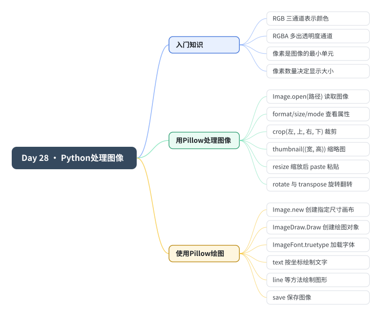

## Python处理图像



### 入门知识

1. 颜色。如果你有使用颜料画画的经历，那么一定知道混合红、黄、蓝三种颜料可以得到其他的颜色，事实上这三种颜色就是美术中的三原色，它们是不能再分解的基本颜色。在计算机中，我们可以将红、绿、蓝三种色光以不同的比例叠加来组合成其他的颜色，因此这三种颜色就是色光三原色。在计算机系统中，我们通常会将一个颜色表示为一个 RGB 值或 RGBA 值（其中的 A 表示 Alpha 通道，它决定了透过这个图像的像素，也就是透明度）。

   |    名称     |      RGB值      |     名称     |     RGB值     |
   | :---------: | :-------------: | :----------: | :-----------: |
   | White（白） | (255, 255, 255) |  Red（红）   |  (255, 0, 0)  |
   | Green（绿） |   (0, 255, 0)   |  Blue（蓝）  |  (0, 0, 255)  |
   | Gray（灰）  | (128, 128, 128) | Yellow（黄） | (255, 255, 0) |
   | Black（黑） |    (0, 0, 0)    | Purple（紫） | (128, 0, 128) |

2. 像素。对于一个由数字序列表示的图像来说，最小的单位就是图像上单一颜色的小方格，这些小方块都有一个明确的位置和被分配的色彩数值，而这些一小方格的颜色和位置决定了该图像最终呈现出来的样子，它们是不可分割的单位，我们通常称之为像素（pixel）。每一个图像都包含了一定量的像素，这些像素决定图像在屏幕上所呈现的大小，大家如果爱好拍照或者自拍，对像素这个词就不会陌生。

### 用Pillow处理图像

Pillow 是由从著名的 Python 图像处理库 PIL 发展出来的一个分支，通过 Pillow 可以实现图像压缩和图像处理等各种操作。可以使用下面的命令来安装 Pillow。

```Shell
pip install pillow
```

Pillow 中最为重要的是`Image`类，可以通过`Image`模块的`open`函数来读取图像并获得`Image`类型的对象。

1. 读取和显示图像

   ```python
   from PIL import Image
   
   # 读取图像获得Image对象
   image = Image.open('guido.jpg')
   # 通过Image对象的format属性获得图像的格式
   print(image.format) # JPEG
   # 通过Image对象的size属性获得图像的尺寸
   print(image.size)   # (500, 750)
   # 通过Image对象的mode属性获取图像的模式
   print(image.mode)   # RGB
   # 通过Image对象的show方法显示图像
   image.show()
   ```

   

2. 剪裁图像

   ```python
   # 通过Image对象的crop方法指定剪裁区域剪裁图像
   image.crop((80, 20, 310, 360)).show()
   ```

   

3. 生成缩略图

   ```python
   # 通过Image对象的thumbnail方法生成指定尺寸的缩略图
   image.thumbnail((128, 128))
   image.show()
   ```

   

4. 缩放和黏贴图像

   ```python
   # 读取骆昊的照片获得Image对象
   luohao_image = Image.open('luohao.png')
   # 读取吉多的照片获得Image对象
   guido_image = Image.open('guido.jpg')
   # 从吉多的照片上剪裁出吉多的头
   guido_head = guido_image.crop((80, 20, 310, 360))
   width, height = guido_head.size
   # 使用Image对象的resize方法修改图像的尺寸
   # 使用Image对象的paste方法将吉多的头粘贴到骆昊的照片上
   luohao_image.paste(guido_head.resize((int(width / 1.5), int(height / 1.5))), (172, 40))
   luohao_image.show()
   ```

   

5. 旋转和翻转

   ```python
   image = Image.open('guido.jpg')
   # 使用Image对象的rotate方法实现图像的旋转
   image.rotate(45).show()
   # 使用Image对象的transpose方法实现图像翻转
   # Image.FLIP_LEFT_RIGHT - 水平翻转
   # Image.FLIP_TOP_BOTTOM - 垂直翻转
   image.transpose(Image.FLIP_TOP_BOTTOM).show()
   ```

   

6. 操作像素

   ```python
   for x in range(80, 310):
       for y in range(20, 360):
           # 通过Image对象的putpixel方法修改图像指定像素点
           image.putpixel((x, y), (128, 128, 128))
   image.show()
   ```

   

7. 滤镜效果

   ```python
   from PIL import ImageFilter
   
   # 使用Image对象的filter方法对图像进行滤镜处理
   # ImageFilter模块包含了诸多预设的滤镜也可以自定义滤镜
   image.filter(ImageFilter.CONTOUR).show()
   ```

   

### 使用Pillow绘图

Pillow 中有一个名为`ImageDraw`的模块，该模块的`Draw`函数会返回一个`ImageDraw`对象，通过`ImageDraw`对象的`arc`、`line`、`rectangle`、`ellipse`、`polygon`等方法，可以在图像上绘制出圆弧、线条、矩形、椭圆、多边形等形状，也可以通过该对象的`text`方法在图像上添加文字。


要绘制如上图所示的图像，完整的代码如下所示。

```python
import random

from PIL import Image, ImageDraw, ImageFont


def random_color():
    """生成随机颜色"""
    red = random.randint(0, 255)
    green = random.randint(0, 255)
    blue = random.randint(0, 255)
    return red, green, blue


width, height = 800, 600
# 创建一个800*600的图像，背景色为白色
image = Image.new(mode='RGB', size=(width, height), color=(255, 255, 255))
# 创建一个ImageDraw对象
drawer = ImageDraw.Draw(image)
# 通过指定字体和大小获得ImageFont对象
font = ImageFont.truetype('Kongxin.ttf', 32)
# 通过ImageDraw对象的text方法绘制文字
drawer.text((300, 50), 'Hello, world!', fill=(255, 0, 0), font=font)
# 通过ImageDraw对象的line方法绘制两条对角直线
drawer.line((0, 0, width, height), fill=(0, 0, 255), width=2)
drawer.line((width, 0, 0, height), fill=(0, 0, 255), width=2)
xy = width // 2 - 60, height // 2 - 60, width // 2 + 60, height // 2 + 60
# 通过ImageDraw对象的rectangle方法绘制矩形
drawer.rectangle(xy, outline=(255, 0, 0), width=2)
# 通过ImageDraw对象的ellipse方法绘制椭圆
for i in range(4):
    left, top, right, bottom = 150 + i * 120, 220, 310 + i * 120, 380
    drawer.ellipse((left, top, right, bottom), outline=random_color(), width=8)
# 显示图像
image.show()
# 保存图像
image.save('result.png')
```

> **注意**：上面代码中使用的字体文件需要根据自己准备，可以选择自己喜欢的字体文件并放置在代码目录下。

###  总结

本节核心语法与用法：

- **入门知识**：计算机用 RGB 三通道叠加表示颜色，RGBA 额外带 Alpha 透明度；像素是图像最小颜色单元，像素总量决定显示尺寸。
- **用Pillow处理图像**：`Image.open(路径)` 读图，`format`/`size`/`mode` 看属性，`crop(左, 上, 右, 下)` 裁剪，`thumbnail((宽, 高))` 缩略，`resize` 缩放后 `paste(图, 坐标)` 粘贴，`rotate(角度)`/`transpose(Image.FLIP_TOP_BOTTOM)` 旋转翻转。
- **使用Pillow绘图**：`Image.new(mode, size, color)` 建画布，`ImageDraw.Draw(图像对象)` 得绘图对象，`ImageFont.truetype(字体, 字号)` 加载字体，`text`/`line`/`rectangle`/`ellipse` 绘制，`save(路径)` 保存。

### 每日任务

1. **读取与缩略图**：用 `Image.open` 打开图片，打印 `format`、`size`、`mode`，调用 `thumbnail((128, 128))` 生成缩略图并用 `save` 保存；对比保存前后 `size` 的变化。
2. **裁剪与合成**：用 `crop((80, 20, 310, 360))` 裁出人像头部，`resize` 后通过 `paste` 粘贴到另一张图的 `(172, 40)` 位置；再分别用 `rotate(45)` 和 `transpose(Image.FLIP_TOP_BOTTOM)` 生成两张变体并保存。
3. **绘图与排错**：用 `Image.new('RGB', (800, 600), 'white')` 和 `ImageDraw.Draw` 绘制两条对角线、一个矩形、四个 `ellipse` 及 `text` 文字，颜色由 `random.randint(0, 255)` 生成；说明对整块区域逐像素 `putpixel` 为什么慢，以及 `RGBA` 图像粘贴到 `RGB` 图像时透明度会怎样处理。
