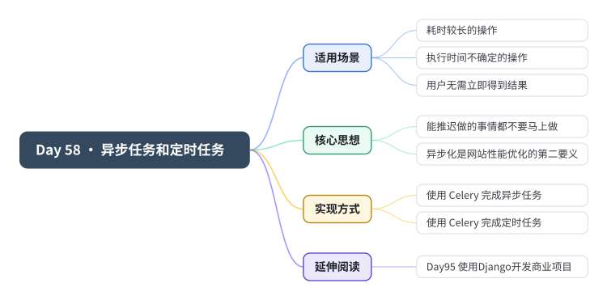

## 异步任务和定时任务

在Web应用中，如果一个请求执行了耗时间的操作或者该请求的执行时间无法确定，而且对于用户来说只需要知道服务器接收了他的请求，并不需要马上得到请求的执行结果，这样的操作我们就应该对其进行异步化处理。如果说**使用缓存是优化网站性能的第一要义**，那么将耗时间或执行时间不确定的任务**异步化则是网站性能优化的第二要义**，简单的说就是**能推迟做的事情都不要马上做**。

上一章节中讲到的发短信和上传文件到云存储为例，这两个操作前者属于时间不确定的操作（因为作为调用者，我们不能确定三方平台响应的时间），后者属于耗时间的操作（如果文件较大或者三方平台不稳定，都可能导致上传的时间较长），很显然，这两个操作都可以做异步化处理。

在 Python 项目中，我们可以使用三方库Celery来完成异步任务和定时任务，关于Celery的内容，请移步到[《使用Django开发商业项目》](../Day91-100/95.使用Django开发商业项目.md)一文。

### 总结

本节说明了异步任务和定时任务的使用场景：对于耗时较长或执行时间不确定、且用户不需要立即获得结果的操作，应当进行异步化处理。在 Python 项目中通常使用 Celery 实现异步任务和定时任务，具体用法请参阅《使用Django开发商业项目》一文。

### 每日任务

1. **异步发短信**：把 `send_mobile_code(tel, code)` 改写成用 `@shared_task` 装饰的 Celery 任务，视图里调用 `task.delay(tel, code)` 后立即返回“验证码已发送”；要求启动 `celery -A 项目名 worker -l info`，并验证接口响应时间不再受短信网关影响。
2. **定时任务**：在 Celery 配置中用 `beat_schedule` 注册一个 `crontab(minute=0, hour=2)` 的任务，例如每天凌晨统计各学科好评总数并写入一张汇总表；要求同时启动 `beat` 与 `worker`，并说明 `timezone` 配置对执行时刻的影响。
3. **可靠性思考**：给任务加上 `bind=True, max_retries=3` 并在异常时调用 `self.retry(countdown=60)`，说明为什么任务必须设计成幂等的；再解释 `apply_async(countdown=...)` 与 `delay` 的区别，以及不配置 result backend 时能否用 `AsyncResult` 取回结果。
