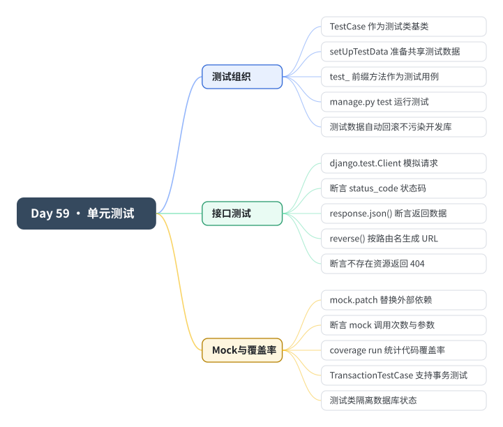

## 单元测试

请各位读者移步到[《使用Django开发商业项目》](../Day91-100/95.使用Django开发商业项目.md)一文。

### 总结

本节没有展开讲解单元测试的具体内容，而是将相关知识点安排在《使用Django开发商业项目》一文中，读者可以移步该文继续学习。

### 每日任务

1. **模型测试**：新建 `tests.py`，继承 `django.test.TestCase`，在 `setUpTestData` 中创建 2 个学科和 3 位老师，断言 `Subject.objects.count()`、外键关系与 `__str__` 返回值；要求用 `python manage.py test` 一次跑通并且不污染开发数据库。
2. **接口测试**：用 `django.test.Client` 请求 `/api/subjects/`，断言 `status_code == 200`、`response.json()` 的长度和字段；再请求不存在的学科编号，断言返回 404，并要求使用 `reverse()` 生成 URL 而不是硬编码路径。
3. **Mock 与覆盖率**：用 `unittest.mock.patch` 替换 `send_mobile_code`，测试注册接口时断言它被调用一次且参数为手机号与 6 位验证码；再说明 `TestCase` 与 `TransactionTestCase` 在数据库回滚上的区别，以及如何用 `coverage run manage.py test` 查看未覆盖分支。
