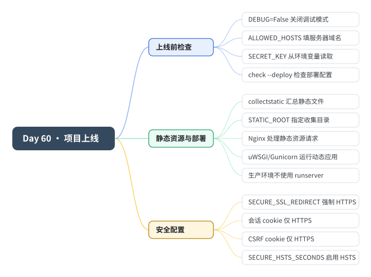

## 项目上线

请各位读者移步到[《项目部署上线和性能调优》](../Day91-100/98.项目部署上线和性能调优.md)一文。

### 总结

本节核心语法与用法：

- **上线前检查**：把 `DEBUG` 设为 `False`、`ALLOWED_HOSTS` 填入服务器域名或 IP、`SECRET_KEY` 改为从环境变量读取而不是写死在代码中；执行 `python manage.py check --deploy` 逐条检查部署相关的警告并修正配置。
- **静态资源与部署**：执行 `python manage.py collectstatic` 把各应用静态文件汇总到 `STATIC_ROOT`；生产环境由 Nginx 直接处理 `/static/` 和 `/media/`，动态请求反向代理给 uWSGI 或 Gunicorn 运行 Django 应用；`runserver` 只是开发服务器，不能用于生产。
- **安全配置**：用 `SECURE_SSL_REDIRECT = True` 把 HTTP 重定向到 HTTPS，`SESSION_COOKIE_SECURE = True` 和 `CSRF_COOKIE_SECURE = True` 让会话与 CSRF cookie 只在 HTTPS 下传输，`SECURE_HSTS_SECONDS` 启用 HSTS 强制浏览器使用 HTTPS；同时检查数据库口令、日志目录权限和 `error.log` 可写性。

### 每日任务

1. **上线前检查**：把 `DEBUG` 改为 `False`、`ALLOWED_HOSTS` 填为服务器域名、`SECRET_KEY` 改从环境变量读取，然后执行 `python manage.py check --deploy`；要求记录每条 warning 对应的配置项及修复方式。
2. **静态资源与部署**：执行 `python manage.py collectstatic` 汇总静态文件，画出“Nginx 处理 `/static/` 与 `/media/`，动态请求转发给 uWSGI/Gunicorn”的部署结构；要求说明为什么生产环境不能使用 `runserver`，以及 `STATIC_ROOT` 与 `STATICFILES_DIRS` 的区别。
3. **安全清单**：配置 `SECURE_SSL_REDIRECT`、`SESSION_COOKIE_SECURE`、`CSRF_COOKIE_SECURE` 与 `SECURE_HSTS_SECONDS`，并检查数据库口令、日志目录权限和 `error.log` 是否可写；要求给出上线后验证 HTTPS 跳转和静态资源 200 响应的具体命令或步骤。
