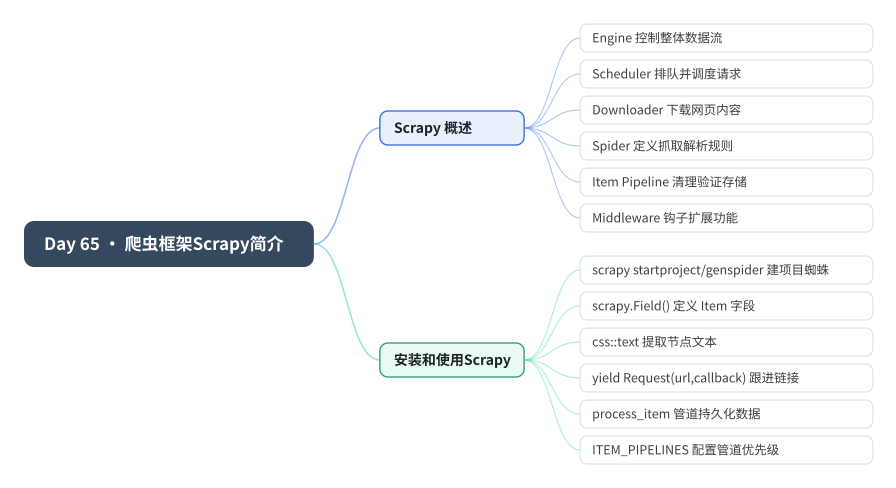

## 爬虫框架Scrapy简介



当你写了很多个爬虫程序之后，你会发现每次写爬虫程序时，都需要将页面获取、页面解析、爬虫调度、异常处理、反爬应对这些代码从头至尾实现一遍，这里面有很多工作其实都是简单乏味的重复劳动。那么，有没有什么办法可以提升我们编写爬虫代码的效率呢？答案是肯定的，那就是利用爬虫框架，而在所有的爬虫框架中，Scrapy 应该是最流行、最强大的框架。

### Scrapy 概述

Scrapy 是基于 Python 的一个非常流行的网络爬虫框架，可以用来抓取 Web 站点并从页面中提取结构化的数据。下图展示了 Scrapy 的基本架构，其中包含了主要组件和系统的数据处理流程（图中带数字的红色箭头）。


#### Scrapy的组件

我们先来说说 Scrapy 中的组件。

1. Scrapy 引擎（Engine）：用来控制整个系统的数据处理流程。
2. 调度器（Scheduler）：调度器从引擎接受请求并排序列入队列，并在引擎发出请求后返还给它们。
3. 下载器（Downloader）：下载器的主要职责是抓取网页并将网页内容返还给蜘蛛（Spiders）。
4. 蜘蛛程序（Spiders）：蜘蛛是用户自定义的用来解析网页并抓取特定URL的类，每个蜘蛛都能处理一个域名或一组域名，简单的说就是用来定义特定网站的抓取和解析规则的模块。
5. 数据管道（Item Pipeline）：管道的主要责任是负责处理有蜘蛛从网页中抽取的数据条目，它的主要任务是清理、验证和存储数据。当页面被蜘蛛解析后，将被发送到数据管道，并经过几个特定的次序处理数据。每个数据管道组件都是一个 Python 类，它们获取了数据条目并执行对数据条目进行处理的方法，同时还需要确定是否需要在数据管道中继续执行下一步或是直接丢弃掉不处理。数据管道通常执行的任务有：清理 HTML 数据、验证解析到的数据（检查条目是否包含必要的字段）、检查是不是重复数据（如果重复就丢弃）、将解析到的数据存储到数据库（关系型数据库或 NoSQL 数据库）中。
6. 中间件（Middlewares）：中间件是介于引擎和其他组件之间的一个钩子框架，主要是为了提供自定义的代码来拓展 Scrapy 的功能，包括下载器中间件和蜘蛛中间件。

#### 数据处理流程

Scrapy 的整个数据处理流程由引擎进行控制，通常的运转流程包括以下的步骤：

1. 引擎询问蜘蛛需要处理哪个网站，并让蜘蛛将第一个需要处理的 URL 交给它。

2. 引擎让调度器将需要处理的 URL 放在队列中。

3. 引擎从调度那获取接下来进行爬取的页面。

4. 调度将下一个爬取的 URL 返回给引擎，引擎将它通过下载中间件发送到下载器。

5. 当网页被下载器下载完成以后，响应内容通过下载中间件被发送到引擎；如果下载失败了，引擎会通知调度器记录这个 URL，待会再重新下载。

6. 引擎收到下载器的响应并将它通过蜘蛛中间件发送到蜘蛛进行处理。

7. 蜘蛛处理响应并返回爬取到的数据条目，此外还要将需要跟进的新的 URL 发送给引擎。

8. 引擎将抓取到的数据条目送入数据管道，把新的 URL 发送给调度器放入队列中。

上述操作中的第2步到第8步会一直重复直到调度器中没有需要请求的 URL，爬虫就停止工作。

### 安装和使用Scrapy

可以使用 Python 的包管理工具`pip`来安装 Scrapy。

```Shell
pip install scrapy
```

在命令行中使用`scrapy`命令创建名为`demo`的项目。

```Bash
scrapy startproject demo
```

项目的目录结构如下图所示。

```Shell
demo
|____ demo
|________ spiders
|____________ __init__.py
|________ __init__.py
|________ items.py
|________ middlewares.py
|________ pipelines.py
|________ settings.py
|____ scrapy.cfg
```

切换到`demo` 目录，用下面的命令创建名为`douban`的蜘蛛程序。

```Bash
scrapy genspider douban movie.douban.com
```

#### 一个简单的例子

接下来，我们实现一个爬取豆瓣电影 Top250 电影标题、评分和金句的爬虫。

1. 在`items.py`的`Item`类中定义字段，这些字段用来保存数据，方便后续的操作。

   ```Python
   import scrapy
   
   
   class DoubanItem(scrapy.Item):
       title = scrapy.Field()
       score = scrapy.Field()
       motto = scrapy.Field()
   ```
   
2. 修改`spiders`文件夹中名为`douban.py` 的文件，它是蜘蛛程序的核心，需要我们添加解析页面的代码。在这里，我们可以通过对`Response`对象的解析，获取电影的信息，代码如下所示。

   ```Python
   import scrapy
   from scrapy import Selector, Request
   from scrapy.http import HtmlResponse
   
   from demo.items import MovieItem
   
   
   class DoubanSpider(scrapy.Spider):
       name = 'douban'
       allowed_domains = ['movie.douban.com']
       start_urls = ['https://movie.douban.com/top250?start=0&filter=']
   
       def parse(self, response: HtmlResponse):
           sel = Selector(response)
           movie_items = sel.css('#content > div > div.article > ol > li')
           for movie_sel in movie_items:
               item = MovieItem()
               item['title'] = movie_sel.css('.title::text').extract_first()
               item['score'] = movie_sel.css('.rating_num::text').extract_first()
               item['motto'] = movie_sel.css('.inq::text').extract_first()
               yield item
   ```
   通过上面的代码不难看出，我们可以使用 CSS 选择器进行页面解析。当然，如果你愿意也可以使用 XPath 或正则表达式进行页面解析，对应的方法分别是`xpath`和`re`。

   如果还要生成后续爬取的请求，我们可以用`yield`产出`Request`对象。`Request`对象有两个非常重要的属性，一个是`url`，它代表了要请求的地址；一个是`callback`，它代表了获得响应之后要执行的回调函数。我们可以将上面的代码稍作修改。

   ```Python
   import scrapy
   from scrapy import Selector, Request
   from scrapy.http import HtmlResponse
   
   from demo.items import MovieItem
   
   
   class DoubanSpider(scrapy.Spider):
       name = 'douban'
       allowed_domains = ['movie.douban.com']
       start_urls = ['https://movie.douban.com/top250?start=0&filter=']
   
       def parse(self, response: HtmlResponse):
           sel = Selector(response)
           movie_items = sel.css('#content > div > div.article > ol > li')
           for movie_sel in movie_items:
               item = MovieItem()
               item['title'] = movie_sel.css('.title::text').extract_first()
               item['score'] = movie_sel.css('.rating_num::text').extract_first()
               item['motto'] = movie_sel.css('.inq::text').extract_first()
               yield item
   
           hrefs = sel.css('#content > div > div.article > div.paginator > a::attr("href")')
           for href in hrefs:
               full_url = response.urljoin(href.extract())
               yield Request(url=full_url)
   ```

   到这里，我们已经可以通过下面的命令让爬虫运转起来。

   ```Shell
   scrapy crawl movie
   ```

   可以在控制台看到爬取到的数据，如果想将这些数据保存到文件中，可以通过`-o`参数来指定文件名，Scrapy 支持我们将爬取到的数据导出成 JSON、CSV、XML 等格式。

   ```Shell
   scrapy crawl moive -o result.json
   ```

   不知大家是否注意到，通过运行爬虫获得的 JSON 文件中有`275`条数据，那是因为首页被重复爬取了。要解决这个问题，可以对上面的代码稍作调整，不在`parse`方法中解析获取新页面的 URL，而是通过`start_requests`方法提前准备好待爬取页面的 URL，调整后的代码如下所示。

   ```Python
   import scrapy
   from scrapy import Selector, Request
   from scrapy.http import HtmlResponse
   
   from demo.items import MovieItem
   
   
   class DoubanSpider(scrapy.Spider):
       name = 'douban'
       allowed_domains = ['movie.douban.com']
   
       def start_requests(self):
           for page in range(10):
               yield Request(url=f'https://movie.douban.com/top250?start={page * 25}')
   
       def parse(self, response: HtmlResponse):
           sel = Selector(response)
           movie_items = sel.css('#content > div > div.article > ol > li')
           for movie_sel in movie_items:
               item = MovieItem()
               item['title'] = movie_sel.css('.title::text').extract_first()
               item['score'] = movie_sel.css('.rating_num::text').extract_first()
               item['motto'] = movie_sel.css('.inq::text').extract_first()
               yield item
   ```

3. 如果希望完成爬虫数据的持久化，可以在数据管道中处理蜘蛛程序产生的`Item`对象。例如，我们可以通过前面讲到的`openpyxl`操作 Excel 文件，将数据写入 Excel 文件中，代码如下所示。

   ```Python
   import openpyxl
   
   from demo.items import MovieItem
   
   
   class MovieItemPipeline:
   
       def __init__(self):
           self.wb = openpyxl.Workbook()
           self.sheet = self.wb.active
           self.sheet.title = 'Top250'
           self.sheet.append(('名称', '评分', '名言'))
   
       def process_item(self, item: MovieItem, spider):
           self.sheet.append((item['title'], item['score'], item['motto']))
           return item
   
       def close_spider(self, spider):
           self.wb.save('豆瓣电影数据.xlsx')
   ```

   上面的`process_item`和`close_spider`都是回调方法（钩子函数）， 简单的说就是 Scrapy 框架会自动去调用的方法。当蜘蛛程序产生一个`Item`对象交给引擎时，引擎会将该`Item`对象交给数据管道，这时我们配置好的数据管道的`parse_item`方法就会被执行，所以我们可以在该方法中获取数据并完成数据的持久化操作。另一个方法`close_spider`是在爬虫结束运行前会自动执行的方法，在上面的代码中，我们在这个地方进行了保存 Excel 文件的操作，相信这段代码大家是很容易读懂的。

   总而言之，数据管道可以帮助我们完成以下操作：

   - 清理 HTML 数据，验证爬取的数据。
   - 丢弃重复的不必要的内容。
   - 将爬取的结果进行持久化操作。

4. 修改`settings.py`文件对项目进行配置，主要需要修改以下几个配置。

   ```Python
   # 用户浏览器
   USER_AGENT = 'Mozilla/5.0 (Macintosh; Intel Mac OS X 10_14_6) AppleWebKit/537.36 (KHTML, like Gecko) Chrome/92.0.4515.159 Safari/537.36'
   
   # 并发请求数量 
   CONCURRENT_REQUESTS = 4
   
   # 下载延迟
   DOWNLOAD_DELAY = 3
   # 随机化下载延迟
   RANDOMIZE_DOWNLOAD_DELAY = True
   
   # 是否遵守爬虫协议
   ROBOTSTXT_OBEY = True
   
   # 配置数据管道
   ITEM_PIPELINES = {
      'demo.pipelines.MovieItemPipeline': 300,
   }
   ```

   > **说明**：上面配置文件中的`ITEM_PIPELINES`选项是一个字典，可以配置多个处理数据的管道，后面的数字代表了执行的优先级，数字小的先执行。

### 总结

本节核心语法与用法：

- **Scrapy 概述**：引擎（Engine）控制数据流，调度器（Scheduler）把 `Request` 排队，下载器（Downloader）取回响应，Spider 解析并 `yield` Item/新 Request，Item Pipeline 清理验证存储，Middleware 在组件间插入自定义逻辑；流程循环直到队列为空。
- **安装和使用Scrapy**：`pip install scrapy` 后，`scrapy startproject 项目名` 建项目、`scrapy genspider 名 域名` 建蜘蛛；在 `items.py` 用 `scrapy.Field()` 定义字段，`parse` 中用 `css('...::text').extract_first()` 或 `xpath()` 提取，`yield` Item 对象交给管道，`yield Request(url, callback=...)` 跟进链接；`process_item` 持久化，`settings.py` 配置 `ITEM_PIPELINES`、`DOWNLOAD_DELAY`、`CONCURRENT_REQUESTS`、`ROBOTSTXT_OBEY`；`scrapy crawl 名 -o 结果.json` 运行并导出。

### 每日任务

1. **Item 与 CSS 提取**：用 `scrapy startproject demo` 和 `scrapy genspider books 127.0.0.1:8000` 创建项目（用 `python -m http.server 8000` 提供本地 `books.html`），在 `items.py` 定义 `title`、`price` 两个 `scrapy.Field()`，在 `parse` 中用 `response.css('li.book')` 遍历并 `yield item`，通过 `scrapy crawl books -o result.json` 验证输出条数。
2. **分页 Request 与去重**：在 `parse` 中提取 `a.next::attr(href)`，用 `response.urljoin(href)` 生成完整地址并 `yield scrapy.Request(url=..., callback=self.parse)`；说明为什么首页会被重复抓取，以及改用 `start_requests` 预先生成 10 个分页 URL 后结果条数如何变化。
3. **Pipeline 持久化**：写一个 `process_item` 用 `openpyxl` 的 `sheet.append` 写入三列，`close_spider` 中 `wb.save('books.xlsx')`；在 `settings.py` 配置 `ITEM_PIPELINES = {'demo.pipelines.BookPipeline': 300}`，并说明数字 300 的含义以及 `ROBOTSTXT_OBEY`、`DOWNLOAD_DELAY` 对本地测试的影响。
