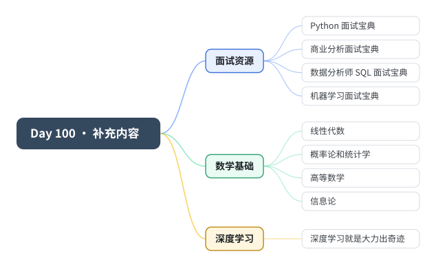

## 补充内容

之前没有来得及安排，准备后面补充的内容：

1. **面试**相关资源请移步到[“Python面试宝典”](https://github.com/jackfrued/Python-Interview-Bible)项目。
    - Python 面试宝典
    - 商业分析面试宝典
    - 数据分析师 SQL 面试宝典
    - 机器学习面试宝典
2. **数学基础**相关资源请移步到[“机器学习数学基础知识”](https://github.com/jackfrued/Math_for_ML)项目。
    - 线性代数
    - 概率论和统计学
    - 高等数学
    - 信息论
3. **深度学习**相关内容请移步到[“深度学习就是大力出奇迹”](https://github.com/jackfrued/Deep-Learning-Is-Nothing)项目。

### 总结

本节汇总了后续补充的学习资源：面试相关资源（Python、商业分析、数据分析师 SQL、机器学习）、机器学习所需的数学基础（线性代数、概率论和统计学、高等数学、信息论），以及深度学习相关项目。可以根据自己的学习方向选择对应资源继续深入。
